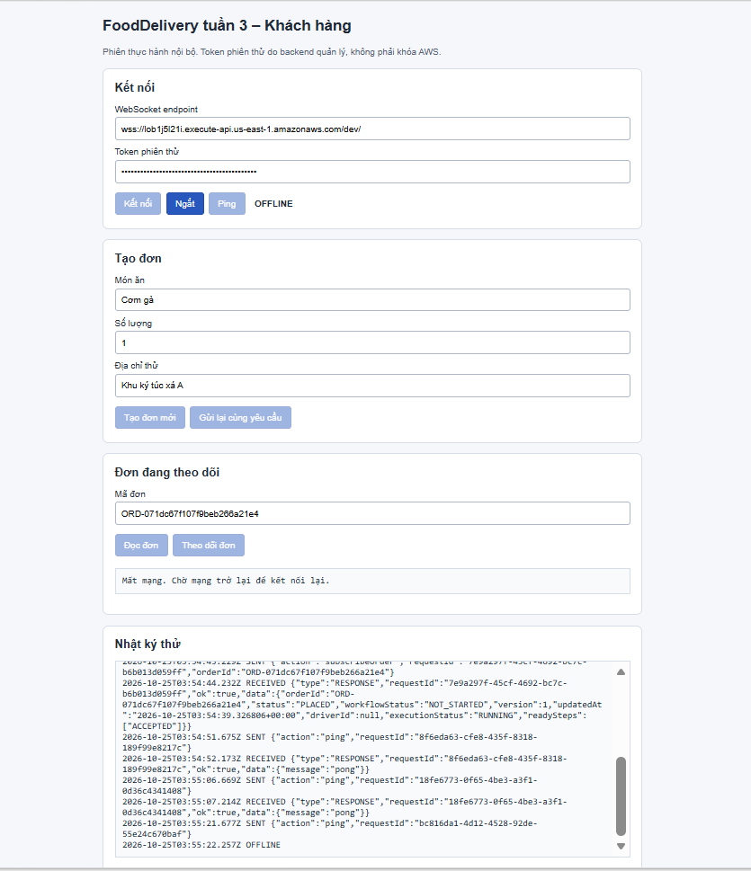
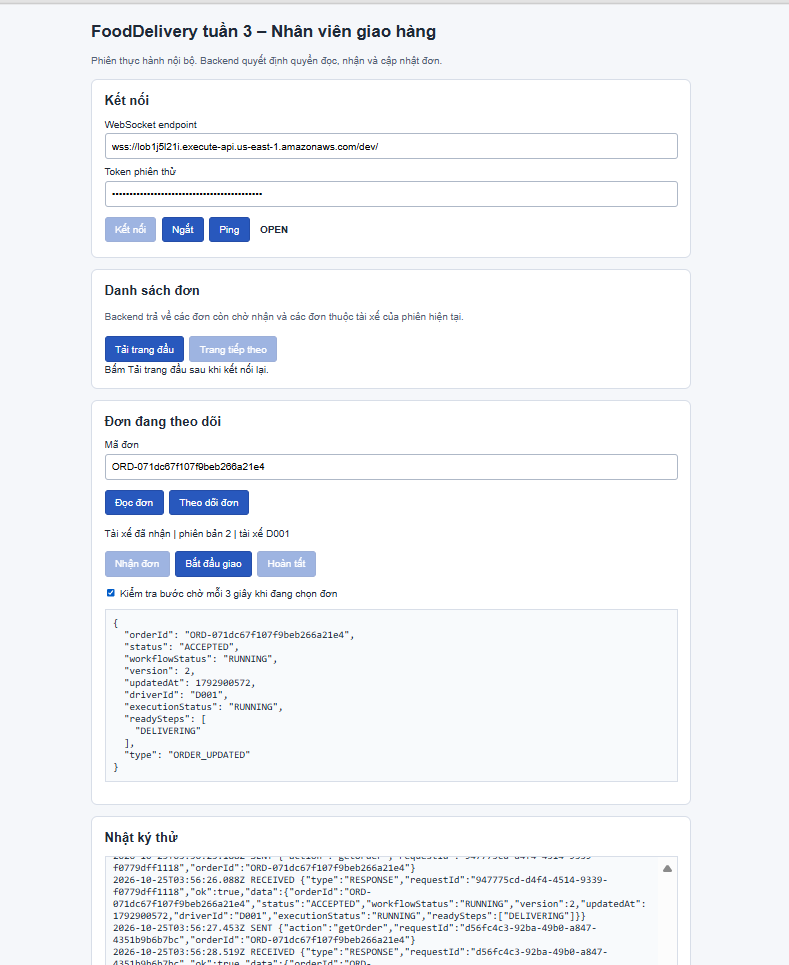
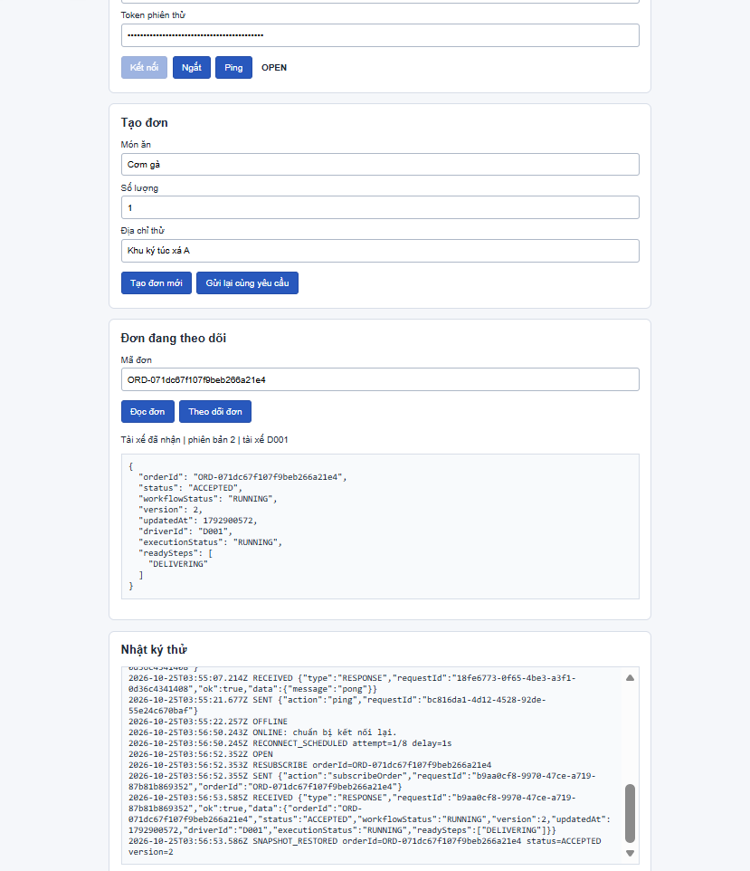
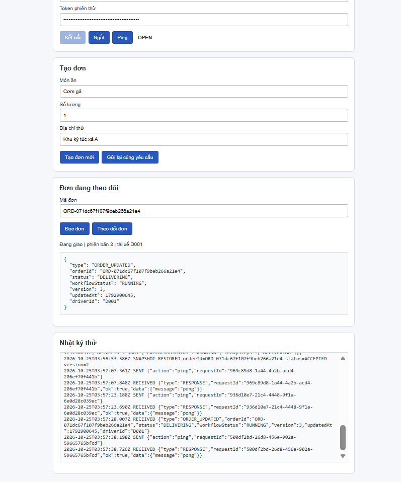
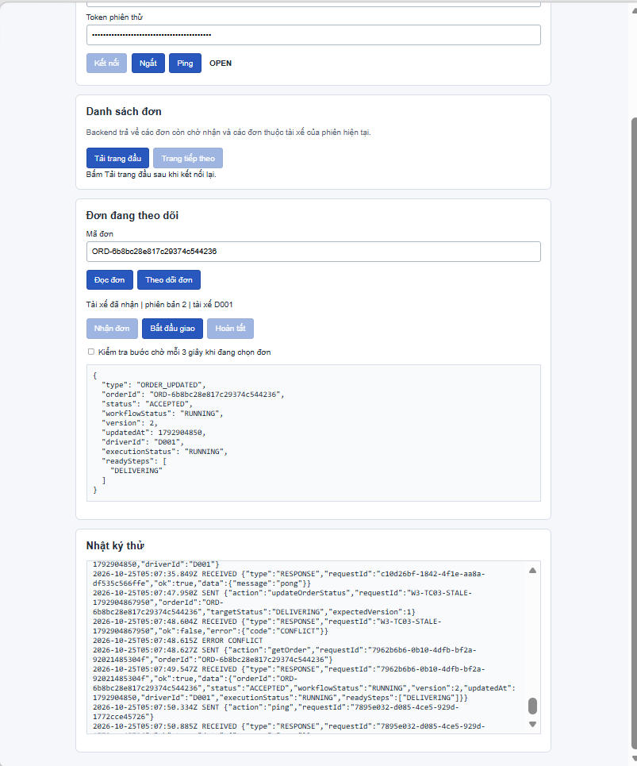
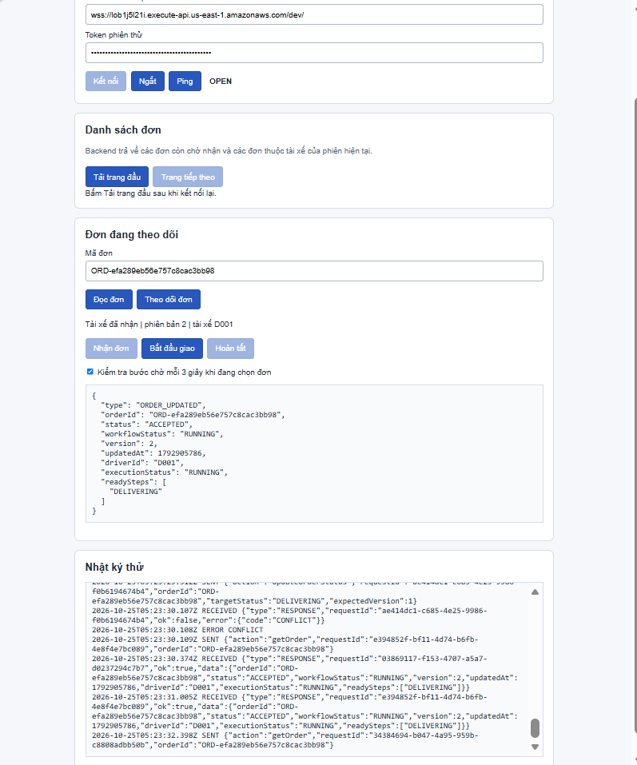
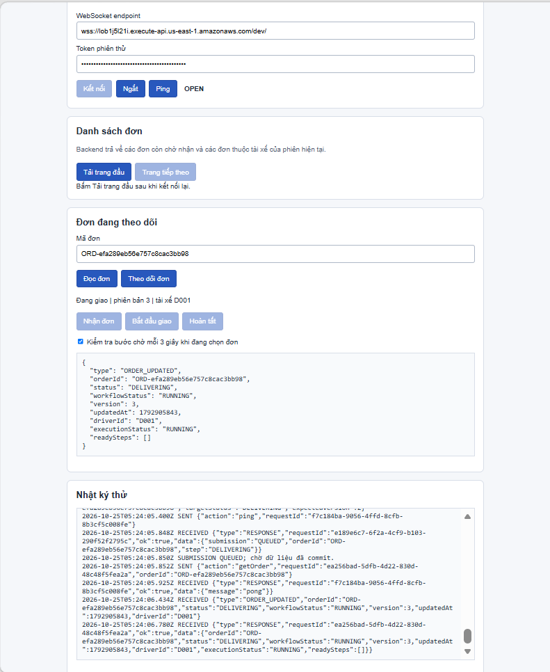
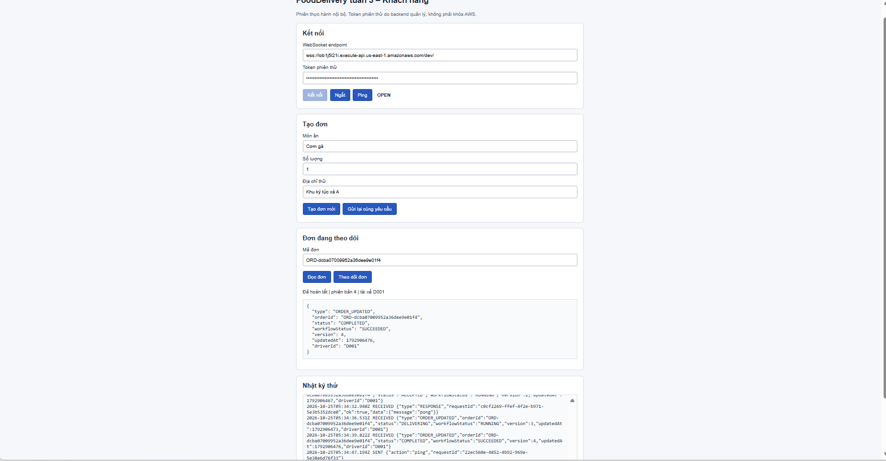
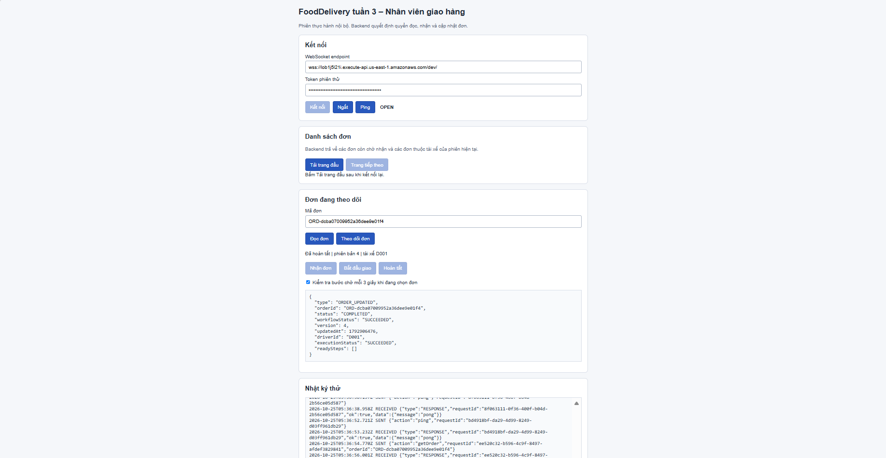

# NHẬT KÝ LÀM VIỆC TUẦN 3 – NGUYỄN LÊ HUY

- Họ và tên: Nguyễn Lê Huy.
- MSSV: 24110221.
- Vai trò: TV2.
- Thời gian tuần 3: 19/10/2026 – 25/10/2026.

## 1. Nhật ký công việc và kiểm thử

### W3-TV2-02 — Hoàn thiện giao diện khách hàng và tài xế

### 1.1. Chuẩn bị mã nguồn giao diện tuần 3

- Ngày thực hiện: 22/10/2026.
- Tạo thư mục `code/LeHuy/Week_03/frontend/`.
- Tạo ba tệp `customer.html`, `driver.html` và `shared.js`.
- Bổ sung logic khóa nút chuyển trạng thái khi đang gửi yêu cầu.
- Bổ sung kiểm tra mã đơn đang chọn trước khi cho phép thao tác.
- Kết quả tại thời điểm chuẩn bị: Đã lưu mã nguồn, chưa kiểm thử với backend AWS. Các kết quả sau được ghi ở những mục tiếp theo.
- Hỗ trợ của AI: ChatGPT hỗ trợ soạn mã nguồn và hướng dẫn kiểm tra. Thành viên thực hiện lưu mã và kiểm thử thực tế.

### Minh chứng

[Minh chứng tạo bộ mã giao diện tuần 3](../../evidence/LeHuy/Week_03/W3-TV2-02_01_FrontendFiles.png)

### 1.2. Kiểm tra kết nối hai giao diện tuần 3

- Ngày thực hiện: 22/10/2026.
- Mở giao diện khách hàng và tài xế từ thư mục Week_03/frontend.
- Kết nối tới WebSocket API của môi trường tích hợp bằng phiên C001 và D001.
- Gửi yêu cầu ping trên từng giao diện.
- Kết quả: Cả hai giao diện hiển thị OPEN và nhận phản hồi pong.
- Phạm vi xác nhận: Kết nối và gửi/nhận thông điệp cơ bản. Chưa kết luận chức năng tạo đơn, chuyển trạng thái hoặc reconnect đạt.

### Minh chứng

[Khách hàng kết nối và nhận pong](../../evidence/LeHuy/Week_03/W3-TV2-02_02_CustomerConnected.png)
[Tài xế kết nối và nhận pong](../../evidence/LeHuy/Week_03/W3-TV2-02_03_DriverConnected.png)

### 1.3. Tạo đơn và kiểm tra thao tác nhận đơn

- Ngày thực hiện: 22/10/2026.
- Mã đơn kiểm thử: `ORD-1ca0c571f442849f9b85cc16` (đối chiếu các ảnh tạo và nhận đơn).
- Tạo đơn từ giao diện khách hàng. Đơn có trạng thái PLACED, version 1.
- Tài xế theo dõi cùng đơn. Nút Nhận đơn được bật khi readySteps có ACCEPTED. Hai nút chuyển bước còn lại bị khóa.
- Bấm nhanh nút Nhận đơn nhiều lần và đối chiếu nhật ký gửi yêu cầu.
- Kết quả: Trong lần thử này, giao diện chỉ gửi một yêu cầu chuyển sang ACCEPTED. Các nút chuyển trạng thái bị khóa trong lúc chờ phản hồi.
- Sau commit, đơn có trạng thái ACCEPTED, version 2. Giao diện khách hàng nhận ORDER_UPDATED và hiển thị trạng thái tương ứng.
- Phạm vi xác nhận: Khóa thao tác tại giao diện và đồng bộ bước nhận đơn. Chưa kết luận kiểm thử cạnh tranh hai tài xế hoặc toàn bộ luồng giao hàng đạt.

### Minh chứng

[Đơn mới PLACED, version 1](../../evidence/LeHuy/Week_03/W3-TV2-02_04_OrderCreated.png)
[Nút Nhận đơn sẵn sàng](../../evidence/LeHuy/Week_03/W3-TV2-02_05_AcceptReady.png)
[Yêu cầu nhận đơn và kết quả](../../evidence/LeHuy/Week_03/W3-TV2-02_06_AcceptRequest.png)
[Khách hàng nhận cập nhật ACCEPTED](../../evidence/LeHuy/Week_03/W3-TV2-02_07_CustomerAccepted.png)

### 1.4. Kiểm tra khóa nút trong lúc gửi yêu cầu

- Mã đơn: ORD-7adb5028048463cb21764756.
- Sau khi gửi yêu cầu nhận đơn, cả ba nút chuyển trạng thái bị khóa trong lúc chờ phản hồi.
- Snapshot tại thời điểm chụp vẫn là PLACED, version 1, readySteps có ACCEPTED.
- Kết quả: Đã quan sát được trạng thái khóa nút khi đang gửi.

### Minh chứng

[Minh chứng khóa nút khi đang gửi](../../evidence/LeHuy/Week_03/W3-TV2-02_06a_ButtonsLocked.png)

### 1.5. Kiểm tra đồng bộ trạng thái giao và hoàn tất đơn

- Ngày thực hiện: 24/10/2026.
- Mã đơn: ORD-746e8af0cf650b5a3c9fb195.
- Tài xế thực hiện chuyển đơn sang DELIVERING. Hai giao diện hiển thị version 3 và driverId D001.
- Tài xế tiếp tục chuyển đơn sang COMPLETED. Hai giao diện hiển thị version 4.
- Nhật ký khách hàng ghi nhận ORDER_UPDATED ở ba mốc ACCEPTED, DELIVERING và COMPLETED.
- Sau hoàn tất, cả ba nút chuyển trạng thái của tài xế đều bị khóa.
- Kết quả: Đạt kiểm tra đồng bộ trạng thái trên hai giao diện.

### Minh chứng

[Tài xế đang giao](../../evidence/LeHuy/Week_03/W3-TV2-02_08_DriverDelivering.png)
[Khách hàng nhận trạng thái đang giao](../../evidence/LeHuy/Week_03/W3-TV2-02_09_CustomerDelivering.png)
[Tài xế hoàn tất đơn](../../evidence/LeHuy/Week_03/W3-TV2-02_10_DriverCompleted.png)
[Khách hàng nhận trạng thái hoàn tất](../../evidence/LeHuy/Week_03/W3-TV2-02_11_CustomerCompleted.png)

### Xác nhận execution hoàn tất

- Mã đơn: `ORD-746e8af0cf650b5a3c9fb195`.
- Step Functions execution: `Succeeded`.
- Kết quả: Đạt luồng giao diện nhận đơn → đang giao → hoàn tất, đồng bộ trạng thái qua WebSocket và execution kết thúc thành công.

### Minh chứng

[Execution thành công](../../evidence/LeHuy/Week_03/W3-TV2-02_12_ExecutionFinal.png)

### W3-TV2-03 — Khôi phục mã đơn sau khi tải lại trang

- Ngày thực hiện: 24/10/2026.
- Lưu mã đơn trong sessionStorage, tách theo đường dẫn giao diện.
- Không lưu token vào sessionStorage.
- Sau F5, giao diện giữ lại mã đơn và hiển thị CLOSED.
- Các nút thao tác bị khóa khi chưa kết nối.
- Sau khi nhập endpoint, token và kết nối lại, giao diện đăng ký theo dõi và lấy lại snapshot của đơn.
- Đơn kiểm thử: `ORD-746e8af0cf650b5a3c9fb195`.
- Snapshot nhận lại: COMPLETED, version 4, driverId D001,
  executionStatus SUCCEEDED.
- Kết quả: Đạt phần khôi phục mã đơn và dữ liệu sau tải lại trang.
- Tại thời điểm kiểm tra tải lại trang chưa kiểm thử tự reconnect. Các lần thử bổ sung được ghi ở những mục tiếp theo.

### Minh chứng

### W3-TV2-03 — Tự kết nối lại sau khi mất mạng

- Ngày thực hiện: 24/10/2026.
- Kiểm thử trên giao diện khách hàng.
- Đơn kiểm thử: `ORD-746e8af0cf650b5a3c9fb195`.
- Khi ngắt mạng, giao diện chuyển sang OFFLINE, giữ mã đơn
  và khóa các nút yêu cầu kết nối.
- Khi bật mạng trở lại, giao diện tự thử kết nối và chuyển sang OPEN.
- Nhật ký ghi nhận ONLINE, RECONNECT_SCHEDULED và OPEN.
- Snapshot được khôi phục: COMPLETED, version 4, driverId D001,
  executionStatus SUCCEEDED.
- Kết quả: Đạt tình huống mất mạng rồi tự kết nối lại.
- Tại lần thử này chưa kiểm tra cập nhật mới sau reconnect và ngắt chủ động; các kết quả bổ sung được ghi bên dưới.

### Minh chứng

### W3-TV2-03 — Ngắt kết nối chủ động

- Ngày thực hiện: 24/10/2026.
- Bấm Ngắt trên giao diện khách hàng.
- Giao diện chuyển sang CLOSED và khóa các nút cần kết nối.
- Nhật ký ghi DISCONNECTED_BY_USER.
- Không thấy lần thử kết nối lại sau dòng ngắt trong ảnh minh chứng.
- Kết quả: Đạt thao tác ngắt chủ động tại thời điểm chụp.

### Minh chứng

### W3-TV2-03 — Nhận cập nhật mới sau khi kết nối lại

- Ngày thực hiện: 24/10/2026.
- Đơn kiểm thử: `ORD-217c2a03e405d72853e6864b`.
- Sau khi mất mạng rồi có mạng trở lại, giao diện tự kết nối,
  đăng ký theo dõi lại và khôi phục snapshot PLACED, version 1.
- Nhật ký có RESUBSCRIBE và SNAPSHOT_RESTORED.
- Sau khi tài xế D001 nhận đơn, giao diện khách hàng nhận
  ORDER_UPDATED và hiển thị ACCEPTED, version 2.
- Kết quả: Đạt khôi phục theo dõi và nhận cập nhật mới sau reconnect.

### Minh chứng

### W3-TV2-04 — Kiểm tra phiên bản cũ và dữ liệu trùng trên giao diện

- Ngày thực hiện: 24/10/2026.
- Đơn kiểm thử: `ORD-746e8af0cf650b5a3c9fb195`.
- Snapshot ban đầu: COMPLETED, version 4, driverId D001.
- Phương pháp: gọi trực tiếp hàm render trong Console trình duyệt.

#### Phiên bản cũ

- Đưa dữ liệu ACCEPTED, version 2 vào hàm render.
- Nhật ký ghi IGNORED_OLD_VERSION, received=2, current=4.
- Giao diện giữ COMPLETED, version 4.
- Kết quả: Đạt.

### Minh chứng

#### Dữ liệu trùng

- Gọi render hai lần với cùng snapshot hiện tại.
- Giao diện giữ COMPLETED, version 4, driverId D001.
- Kết quả: Đạt.

### Minh chứng

Lưu ý: Đây là kiểm thử mô phỏng xử lý hiển thị trên trình duyệt. Chưa xác nhận khả năng chống gửi lặp yêu cầu tại backend.

### W3-TV2-04 — Kiểm tra phân quyền khách hàng

- Ngày thực hiện: 24/10/2026.
- Phiên kiểm thử: C002, sử dụng token được cấu hình ở backend.
- Đơn của C001: `ORD-746e8af0cf650b5a3c9fb195`.
- Gửi getOrder: backend trả ok=false, mã lỗi FORBIDDEN.
- Gửi subscribeOrder: backend trả ok=false, mã lỗi FORBIDDEN.
- Giao diện xóa snapshot cũ và hiển thị thông báo từ chối truy cập.
- Kết nối vẫn OPEN, ping/pong tiếp tục hoạt động.
- Kết quả: Đạt kiểm thử C002 không được đọc hoặc theo dõi đơn của C001.

### Minh chứng

### W3-TV2-04 — Kiểm tra phân quyền tài xế

- Ngày thực hiện: 24/10/2026.
- Phiên kiểm thử: D002.
- Đơn kiểm thử: `ORD-746e8af0cf650b5a3c9fb195`,
  đã hoàn tất và được gán cho D001.
- subscribeOrder trả ok=false, mã lỗi FORBIDDEN.
- getOrder trả ok=false, mã lỗi FORBIDDEN.
- Giao diện không hiển thị snapshot của đơn.
- Các nút Nhận đơn, Bắt đầu giao và Hoàn tất đều bị khóa.
- Kết nối WebSocket vẫn OPEN.
- Kết quả: Đạt kiểm thử D002 không được đọc hoặc theo dõi
  đơn đã gán cho D001.

### Minh chứng

### W3-TV2-05 — Bổ sung log truy vết dispatcher

- Ngày thực hiện: 24/10/2026.
- Bổ sung log JSON cho Lambda fooddelivery-ws-dispatcher.
- Ghi action, requestId, lambdaRequestId, connectionId,
  orderId, actorId, role, outcome, code, delivered và durationMs.
- Điều chỉnh bộ lọc để connectionId được ghi đầy đủ.
- Kiểm thử: D002 gửi getOrder cho đơn
  `ORD-746e8af0cf650b5a3c9fb195` đã gán cho D001.
- CloudWatch ghi nhận code FORBIDDEN và delivered=true.
- Bản ghi kiểm tra không chứa token, địa chỉ hoặc taskToken.
- Kết quả: Đạt ghi log yêu cầu bị từ chối tại dispatcher.
- Tại thời điểm kiểm tra dispatcher chưa đối chiếu log broadcast; kết quả bổ sung được ghi ở mục kế tiếp.

### Minh chứng

### W3-TV2-05 — Bổ sung và kiểm tra log broadcast

- Ngày thực hiện: 24/10/2026.
- Bổ sung log JSON cho Lambda fooddelivery-broadcast.
- Ghi lambdaRequestId, orderId, status, version, outcome, code,
  sent, skipped, gone và durationMs.
- Chạy Lambda Test để phát lại snapshot của đơn
  `ORD-746e8af0cf650b5a3c9fb195`.
- CloudWatch ghi COMPLETED, version 4, BROADCAST_FINISHED.
- Kết quả gửi: sent=1, skipped=0, gone=0.
- Bản ghi kiểm tra không chứa token, địa chỉ hoặc taskToken.
- Kết quả: Đạt kiểm thử log broadcast thành công.
- Các nhánh skipped, gone và lỗi gửi chưa được kiểm thử trong lần này.

### Minh chứng

### W3-TV2-06 — Kiểm tra bấm Nhận đơn liên tục

- Ngày thực hiện: 24/10/2026.
- Đơn kiểm thử: `ORD-d709117de766c314d9e6e0ce`.
- Thực hiện bấm nhanh nút Nhận đơn nhiều lần trên giao diện D001.
- Giao diện nhận phản hồi QUEUED, sau đó nhận ORDER_UPDATED.
- Snapshot sau nhận đơn: ACCEPTED, version 2, driverId D001.
- Tìm trên toàn bộ log streams theo action updateOrderStatus
  và mã đơn trong khoảng thời gian kiểm thử: một bản ghi.
- Bản ghi có actorId D001, code OK và delivered=true.
- requestId khớp phản hồi trên giao diện.
- Kết quả: Đạt chặn thao tác bấm lặp tại frontend trong lần thử này.
- Chưa dùng kết quả này để kết luận backend chống yêu cầu trùng.

### Minh chứng

### W3-TV2-03 — Khôi phục trạng thái đã thay đổi trong lúc mất mạng

- Ngày thực hiện: 25/10/2026.
- Ca kiểm thử: W3-TC07.
- Người thực hiện: Nguyễn Lê Huy – TV2.
- Mã đơn: ORD-071dc67f107f9beb266a21e4.
- Phiên kiểm thử: Khách hàng C001, tài xế D001.
- Phương pháp: Chuyển riêng tab khách hàng sang Offline trong DevTools, giữ tab tài xế online.

#### Thực hiện và kết quả

1. Khách hàng đang theo dõi đơn PLACED, version 1.
2. Khi mất kết nối, giao diện khách hiển thị OFFLINE,
   giữ mã đơn và khóa các nút cần kết nối.
3. Trong thời gian khách còn offline, D001 nhận đơn.
   Giao diện tài xế hiển thị ACCEPTED, version 2.
4. Khi mạng được khôi phục, khách tự kết nối lại,
   không bấm Kết nối hoặc Đọc đơn.
5. Nhật ký ghi nhận RECONNECT_SCHEDULED, OPEN,
   RESUBSCRIBE và SNAPSHOT_RESTORED.
6. Snapshot khôi phục hiển thị ACCEPTED, version 2,
   driverId D001, đúng trạng thái đã thay đổi khi khách offline.
7. D001 tiếp tục chuyển đơn sang DELIVERING.
   Khách nhận ORDER_UPDATED và hiển thị version 3.
- Kết quả: Đạt W3-TC07 trong tình huống kiểm thử này.
- Kết hợp minh chứng ngắt chủ động đã lưu trước đó:
  người dùng bấm Ngắt thì giao diện không tự kết nối lại.

#### Minh chứng

### W3-TV2-04 — Bổ sung kiểm thử phân quyền W3-TC11

- Ngày thực hiện: 25/10/2026.
- Người thực hiện: Nguyễn Lê Huy – TV2.

#### 1. Từ chối cập nhật trái quyền

- Gửi trực tiếp yêu cầu updateOrderStatus từ Console trình duyệt.
- D002 yêu cầu chuyển đơn của D001 sang COMPLETED:
  backend trả FORBIDDEN.
- Phiên khách C002 gửi yêu cầu chuyển trạng thái:
  backend trả FORBIDDEN.
- Đơn kiểm thử: ORD-071dc67f107f9beb266a21e4.
- Snapshot đối chiếu phía D001 vẫn là DELIVERING,
  version 3, driverId D001.
- Kết quả: Đạt phần từ chối cập nhật trái quyền.

#### 2. Từ chối kết nối thiếu hoặc sai token

- Tạo kết nối WebSocket thử trực tiếp bằng endpoint
  lấy từ ô cấu hình giao diện.
- Lần thiếu token: log lúc 04:44:29 UTC.
- Lần token sai: log lúc 04:48:54 UTC.
- Cả hai bản ghi đều có route $connect,
  outcome ERROR và code INVALID_SESSION.
- Trình duyệt báo kết nối thất bại.
- Kết quả: Đạt phần từ chối phiên thiếu/sai token.

#### 3. Kiểm tra broadcast sau khi tài xế mất quyền xem đơn

- Đơn kiểm thử: ORD-5795e7b8c66957d13f26e5ee.
- D002 đăng ký theo dõi thành công khi đơn còn PLACED v1.
- Tắt đọc định kỳ trên giao diện D002.
- D001 nhận đơn, dữ liệu chuyển sang ACCEPTED v2.
- D002 vẫn OPEN và nhận pong nhưng không quan sát thấy
  ORDER_UPDATED của bước ACCEPTED trong lần thử.
- Log broadcast của cùng đơn ghi ACCEPTED v2,
  BROADCAST_FINISHED, sent=2, skipped=1, gone=0.
- Kết quả kết hợp giữa giao diện và log phù hợp với việc
  bỏ qua kết nối D002 khi đơn đã thuộc D001.
- Log tổng hợp không ghi riêng danh tính kết nối bị bỏ qua.
- Kết quả: Đạt tình huống phân quyền broadcast đã kiểm thử.

#### Minh chứng

- [D002 cập nhật bị từ chối](../../evidence/LeHuy/Week_03/W3-TV2-04_07_D002UpdateForbidden.png).
- [Đơn sau yêu cầu bị từ chối](../../evidence/LeHuy/Week_03/W3-TV2-04_08_OrderUnchangedAfterForbidden.png).
- [C002 cập nhật bị từ chối](../../evidence/LeHuy/Week_03/W3-TV2-04_09_C002UpdateForbidden.png).
- [Thiếu token](../../evidence/LeHuy/Week_03/W3-TV2-04_10_MissingTokenRejected.png).
- [Token sai](../../evidence/LeHuy/Week_03/W3-TV2-04_11_InvalidTokenRejected.png).
- [D002 theo dõi trước khi gán đơn](../../evidence/LeHuy/Week_03/W3-TV2-04_12_D002SubscribedBeforeAssignment.png).
- [D001 nhận đơn](../../evidence/LeHuy/Week_03/W3-TV2-04_13_D001Accepted.png).
- [D002 sau khi gán đơn](../../evidence/LeHuy/Week_03/W3-TV2-04_14_D002NoUnauthorizedBroadcast.png).
- [Đối chiếu log broadcast](../../evidence/LeHuy/Week_03/W3-TV2-04_15_BroadcastPermissionCheck.png).

### W3-TV2-06 — Từ chối yêu cầu với version cũ

- Ngày thực hiện: 25/10/2026.
- Ca kiểm thử: W3-TC03.
- Phiên thực hiện: D001.
- Mã đơn: ORD-6b8bc28e817c29374c544236.
- Trạng thái trước kiểm thử: ACCEPTED, version 2.
- Gửi yêu cầu chuyển sang DELIVERING với expectedVersion 1.
- Backend trả CONFLICT. Giao diện ghi ERROR CONFLICT.
- Script kiểm thử tiếp tục gọi readOrder.
- Snapshot trả về vẫn là ACCEPTED, version 2,
  driverId D001, executionStatus RUNNING.
- Kết quả: Đạt phần từ chối version cũ và đọc lại dữ liệu.
- Phạm vi: Script chủ động gọi readOrder sau phản hồi lỗi. Lần thử này chưa xác nhận việc tự tải lại qua nút chuyển trạng thái.

#### Minh chứng

### W3-TV2-06 — Khôi phục thao tác sau CONFLICT

- Ngày thực hiện: 25/10/2026.
- Ca kiểm thử: W3-TC03.
- Phiên thực hiện: D001.
- Mã đơn: ORD-efa289eb56e757c8cac3bb98.
- Trạng thái trước kiểm thử: ACCEPTED, version 2,
  driverId D001, executionStatus RUNNING.

#### Thực hiện và kết quả

1. Mô phỏng expectedVersion 1 cho một yêu cầu gửi từ
   nút Bắt đầu giao.
2. Backend trả CONFLICT. Giao diện ghi ERROR CONFLICT.
3. Nhật ký tiếp tục ghi getOrder và phản hồi ACCEPTED v2.
4. Workflow vẫn RUNNING, readySteps có DELIVERING.
   Nút Bắt đầu giao được bật lại.
5. Bấm Bắt đầu giao lần nữa với version hiện tại.
6. Nhận QUEUED, sau đó nhận ORDER_UPDATED:
   DELIVERING, version 3, driverId D001.
- Kết quả: Đạt phần khôi phục nút sau lỗi và tiếp tục
  chuyển trạng thái bằng yêu cầu hợp lệ.
- Giới hạn: Đọc định kỳ mỗi 3 giây vẫn bật trong lần thử.
  Minh chứng không tách riêng tác động của đọc định kỳ
  với nhánh đọc lại sau lỗi của nút.

#### Minh chứng

### W3-TV2-01 — Đồng bộ cấu hình và adapter

- Ngày đối chiếu: 25/10/2026.
- Dispatcher sử dụng ORDERS_TABLE, CONNECTIONS_TABLE, TASKS_TABLE, STATE_MACHINE_ARN, SUBMIT_LAMBDA_ARN và SESSION_TOKENS_JSON. Chỉ mô tả mục đích phiên demo, không ghi token thật vào tài liệu.
- Adapter orders_api.py chuyển tiếp expectedVersion cùng orderId, targetStatus, requestId; actorId lấy từ danh tính do backend quản lý.
- Broadcast sử dụng ORDERS_TABLE, CONNECTIONS_TABLE, TASKS_TABLE và WS_ENDPOINT_URL. WORKFLOW_TASKS_TABLE của TV1 và TASKS_TABLE của TV2 đều trỏ fooddelivery-workflow-tasks.
- Ảnh cấu hình dispatcher đã được che kín giá trị SESSION_TOKENS_JSON bằng khối đen đặc; kiểm tra xác nhận các pixel bên ngoài vùng che giữ nguyên. Ảnh mã nguồn local không tự chứng minh mã trên AWS khớp hoàn toàn repository.

#### Minh chứng

- [Cấu hình dispatcher](../../evidence/LeHuy/Week_03/W3-TV2-01_01_DispatcherEnvironment.png).
- [Chuyển tiếp expectedVersion](../../evidence/LeHuy/Week_03/W3-TV2-01_02_ExpectedVersionForwarded.png).
- [Cấu hình broadcast](../../evidence/LeHuy/Week_03/W3-TV2-01_03_BroadcastEnvironment.png).

### W3-TV2-01 — Kiểm thử hồi quy sau cập nhật dispatcher

- Ngày thực hiện: 25/10/2026.
- Mã đơn: `ORD-dcba07009952a36dee9e01f4`.
- Phiên kiểm thử: Khách hàng C001 và tài xế D001.
- Thực hiện: Tạo đơn, nhận đơn, bắt đầu giao và hoàn tất.
- Kết quả quan sát:
  - Hai giao diện hiển thị `COMPLETED`, version `4`, `driverId=D001` và `workflowStatus=SUCCEEDED`.
  - Nhật ký khách hàng ghi nhận các cập nhật `DELIVERING` và `COMPLETED` qua sự kiện `ORDER_UPDATED`.
  - Các nút chuyển trạng thái bị khóa sau khi đơn hoàn tất.
  - Sau khi tài xế bấm **Đọc đơn**, snapshot xác nhận `executionStatus=SUCCEEDED`.
- Kết luận: Đạt hồi quy sau cập nhật dispatcher. Lần thử này diễn ra trước khi sửa PersistWorkflowFailure; không mô tả thành kiểm thử toàn luồng thành công sau bản sửa workflow.

#### Minh chứng

### W3-TV2-05 — Cấu hình và xác nhận logging

- Ngày thực hiện: 25/10/2026.
- API fooddelivery-ws, stage dev; cấu hình cuối theo đối chiếu CLI của TV2: LoggingLevel INFO, DataTraceEnabled=false và Custom access logging tắt.
- CloudWatch Logs role ARN: `arn:aws:iam::165662523632:role/LabRole`.
- Log group: `/aws/apigateway/lob1j5l21i/dev`. Execution log thực tế có route `$default`, gọi integration và status 200.
- Log group API Gateway và năm Lambda prepare-task, submit-transition, commit-transition, ws-dispatcher, broadcast đều Never expire tại thời điểm kiểm tra.
- Quyền đã dùng thành công: đọc/cập nhật cấu hình logging, xem log groups/events và cập nhật workflow. Chưa kiểm thử sửa IAM policy, không kết luận bị cấm thao tác này và không coi đây là kiểm toán đầy đủ mọi quyền IAM.
- Ảnh WebSocketLoggingConfigured ghi bước trung gian Errors only; INFO là giá trị cuối do TV2 kiểm tra/cập nhật qua CLI.
- Kết quả: Đạt TC13 trong phạm vi logging và quyền vận hành đã thực hiện.

#### Minh chứng

- [Logging ban đầu](../../evidence/LeHuy/Week_03/W3-TV2-05_01_WebSocketLogging.png).
- [Yêu cầu cấu hình role](../../evidence/LeHuy/Week_03/W3-TV2-05_02_WebSocketLoggingRoleRequired.png).
- [Cấu hình logging trung gian](../../evidence/LeHuy/Week_03/W3-TV2-05_03_WebSocketLoggingConfigured.png).
- [CloudWatch ghi nhận bật logging](../../evidence/LeHuy/Week_03/W3-TV2-05_05_ApiGatewayLoggingWelcome.png).
- [Retention Lambda](../../evidence/LeHuy/Week_03/W3-TV2-05_04_LambdaLogRetention.png).
- [Retention API Gateway](../../evidence/LeHuy/Week_03/W3-TV2-05_05_ApiGatewayLogRetention.png).
- [Execution log API Gateway](../../evidence/LeHuy/Week_03/W3-TV2-05_06_ApiGatewayExecutionLog.png).

### W3-TV2-06 — Nguyên nhân timeout, bản sửa và kết quả trên đơn mới

- Ngày thực hiện: 25/10/2026.
- Đơn cũ ORD-071dc67f107f9beb266a21e4 hết thời gian chờ ở PrepareCompletedTask. HandleTimeout kiểu Pass chỉ ghi workflowError trong dữ liệu execution, chưa cập nhật Orders, dẫn tới execution FAILED nhưng snapshot còn workflowStatus RUNNING.
- Bản workflow-fixed-week3.json tải từ CloudShell sau sửa/triển khai đã được đồng bộ vào config/LeHuy/Week_03/order_workflow_realtime.asl.json; không dùng workflow cũ ghi đè và không sửa ASL TV1 để làm hai tệp giống nhau.
- HandleTimeout ghi workflowError.workflowStatus=TIMED_OUT; HandleWorkflowError ghi FAILED. Cả hai sang PersistWorkflowFailure để gọi DynamoDB UpdateItem lưu workflowStatus và workflowEndedAt trên fooddelivery-orders, sau đó sang WorkflowFailed.
- Điều kiện cập nhật: đơn tồn tại, chưa COMPLETED, executionArn chưa có hoặc trùng execution hiện tại. Không đổi status nghiệp vụ hoặc version. Ba bước commit có Catch States.ALL chuyển HandleWorkflowError; giữ các bước broadcast và luồng nghiệp vụ.
- Đơn kiểm thử sau sửa: ORD-381e33d0155909969f8f2d98. Không nhận đơn và chờ PrepareAcceptedTask timeout 300 giây.
- Kết quả: HandleTimeout → PersistWorkflowFailure (thành công) → WorkflowFailed. Orders giữ PLACED version 1, lưu TIMED_OUT và workflowEndedAt.
- Snapshot trên **giao diện tài xế** có workflowStatus TIMED_OUT, executionStatus FAILED, readySteps rỗng; các nút chuyển trạng thái bị khóa. FAILED là kết quả state Fail được thiết kế.
- Kết luận: Đạt lưu trạng thái timeout trên đơn mới tại bước chờ nhận đơn. Không sửa hồi tố đơn/execution cũ. Chưa kiểm thử riêng lỗi commit hoặc timeout tại cả ba bước. Yêu cầu đến trễ chỉ dẫn theo kết quả TV1 có minh chứng.

#### Minh chứng

- [Workflow cũ kết thúc thất bại](../../evidence/LeHuy/Week_03/W3-TV2-06_06_WorkflowFailureCause.png).
- [Chi tiết callback timeout cũ](../../evidence/LeHuy/Week_03/W3-TV2-06_07_CallbackTimeoutDetails.png).
- [Snapshot tài xế sau sửa](../../evidence/LeHuy/Week_03/W3-TV2-06_08_TimeoutSnapshotAfterFix.png).
- [Workflow sau sửa](../../evidence/LeHuy/Week_03/W3-TV2-06_09_TimeoutWorkflowAfterFix.png).
- [Orders lưu timeout](../../evidence/LeHuy/Week_03/W3-TV2-06_10_TimeoutOrderPersisted.png).

### W3-TV2-07 — Tài nguyên, budget và bàn giao

- Ngày kiểm tra: 25/10/2026.
- Learner Lab hiển thị Used $0 of $50. Đây là số liệu toàn lab, không phải chi phí riêng tuần 3; không suy ra hệ thống không phát sinh chi phí từ số $0 hiển thị.
- Số liệu TV2 cung cấp trước ảnh bổ sung: thời gian lab tích lũy 18:31:00 (1111 phút). Ảnh budget mới hiển thị 18:35:00 (1115 phút); hai số liệu được giữ rõ nguồn, không ghi ảnh mới là 18:31:00.
- Thời gian làm việc tuần 3: chưa tổng hợp.
- Chi phí riêng tuần 3: chưa có số liệu tách riêng. Không dùng thời gian lab tích lũy làm giờ làm tuần 3.
- No running instance chỉ phản ánh thông tin instance trên trang lab; không có nghĩa Lambda/API/DynamoDB đã dừng. Tài nguyên được giữ lại tại thời điểm kiểm thử, không ghi nhận đã End Lab hoặc đã xóa tài nguyên.
- Mã/config được bàn giao theo đường dẫn Week_03 và các lần thử nêu trên. Chưa xác định SHA chính xác của code đã triển khai; SHA commit bàn giao không tự chứng minh SHA đã chạy trên AWS.
- Hỗ trợ AI trong lần hoàn thiện hồ sơ: đối chiếu file, rà soát nội dung, liên kết và tạo commit local; không chạy lại kiểm thử hoặc thay đổi tài nguyên AWS.

#### Minh chứng và tài liệu

- [Budget toàn Learner Lab](../../evidence/LeHuy/Week_03/W3-TV2-07_01_LabBudget.png).
- [Kết quả TC01–TC13](../../tests/Week_03/results.md).
- [Hướng dẫn triển khai](../../design/Week_03/deployment.md).

## 2. Tổng kết và giới hạn

Đã có kết quả giao diện, realtime, reconnect, phân quyền, xử lý version cũ, logging và timeout sau sửa trong phạm vi được mô tả. Hồi quy thành công sau cập nhật dispatcher diễn ra trước PersistWorkflowFailure; chưa chạy toàn luồng thành công sau bản sửa workflow, chưa kiểm thử riêng lỗi commit hoặc timeout tại cả ba bước. Polling còn bật trong ca CONFLICT. Các ca backend được dẫn theo hồ sơ TV1, không tự mở rộng kết luận.

Thời gian làm việc thực tế và SHA code triển khai chưa xác định được giữ rõ trạng thái, không thay bằng số giờ lab hoặc một SHA bất kỳ.

## 3. Commit bàn giao local

Các SHA dưới đây đã tồn tại khi hoàn thiện worklog, chưa push. Đây là commit bàn giao file, không được tự coi là SHA của mã đã triển khai trên AWS.

| Tệp | SHA commit bàn giao |
| --- | --- |
| `code/LeHuy/Week_03/ws_dispatcher/orders_api.py` | `9957af75ec41734fd8f7716168ec480aba536e3a` |
| `config/LeHuy/Week_03/order_workflow_realtime.asl.json` | `76d9e7c6b2d5c7e0f32e25c02920556b2734acb7` |
| `evidence/LeHuy/Week_03/W3-TV2-05_06_ApiGatewayExecutionLog.png` | `ac4377c21fecdc168d65acd5f3a780456ed44cf1` |
| `evidence/LeHuy/Week_03/W3-TV2-06_10_TimeoutOrderPersisted.png` | `ac4377c21fecdc168d65acd5f3a780456ed44cf1` |
| `evidence/LeHuy/Week_03/W3-TV2-07_01_LabBudget.png` | `ac4377c21fecdc168d65acd5f3a780456ed44cf1` |
| `tests/Week_03/results.md` | `d05ee9bdb49d2113fbeea9b7d4f5ac734066373d` |
| `design/Week_03/deployment.md` | `31bf64fe15d3843b75427855ec47f3151d300e65` |
