# NHẬT KÝ LÀM VIỆC TUẦN 3 – NGUYỄN LÊ HUY
- Họ và tên: Nguyễn Lê Huy.
- MSSV: 24110221.
- Vai trò: TV2.
- Thời gian tuần 3: 19/10/2026 – 25/10/2026.

## 1. W3-TV2-02 – Hoàn thiện giao diện khách hàng và tài xế

### 1.1. Chuẩn bị mã nguồn giao diện tuần 3
- Ngày thực hiện: 22/10/2026.
- Tạo thư mục `code/LeHuy/Week_03/frontend/`.
- Tạo ba tệp `customer.html`, `driver.html` và `shared.js`.
- Bổ sung logic khóa nút chuyển trạng thái khi đang gửi yêu cầu.
- Bổ sung kiểm tra mã đơn đang chọn trước khi cho phép thao tác.
- Kết quả: Đã lưu mã nguồn. Chưa kiểm thử hoạt động với backend AWS.
- Hỗ trợ của AI: ChatGPT hỗ trợ soạn mã nguồn và hướng dẫn kiểm tra. Thành viên thực hiện lưu mã và kiểm thử thực tế.
### Minh chứng
[Minh chứng tạo bộ mã giao diện tuần 3](../../evidence/LeHuy/Week_03/W3-TV2-02_01_FrontendFiles.png)

### 1.2. Kiểm tra kết nối hai giao diện tuần 3
- Ngày thực hiện: 22/10/2026.
- Mở giao diện khách hàng và tài xế từ thư mục Week_03/frontend.
- Kết nối tới WebSocket API của môi trường tích hợp bằng phiên C001 và D001.
- Gửi yêu cầu ping trên từng giao diện.
- Kết quả: Cả hai giao diện hiển thị OPEN và nhận phản hồi pong.
- Phạm vi xác nhận: Kết nối và gửi/nhận thông điệp cơ bản. Chưa kết luận chức năng tạo đơn, chuyển trạng thái hoặc reconnect đạt.
### Minh chứng
[Khách hàng kết nối và nhận pong](../../evidence/LeHuy/Week_03/W3-TV2-02_02_CustomerConnected.png)
[Tài xế kết nối và nhận pong](../../evidence/LeHuy/Week_03/W3-TV2-02_03_DriverConnected.png)

### 1.3. Tạo đơn và kiểm tra thao tác nhận đơn
- Ngày thực hiện: 22/10/2026.
- Mã đơn kiểm thử: [Điền mã đơn thực tế].
- Tạo đơn từ giao diện khách hàng. Đơn có trạng thái PLACED, version 1.
- Tài xế theo dõi cùng đơn. Nút Nhận đơn được bật khi readySteps có ACCEPTED. Hai nút chuyển bước còn lại bị khóa.
- Bấm nhanh nút Nhận đơn nhiều lần và đối chiếu nhật ký gửi yêu cầu.
- Kết quả: Trong lần thử này, giao diện chỉ gửi một yêu cầu chuyển sang ACCEPTED. Các nút chuyển trạng thái bị khóa trong lúc chờ phản hồi.
- Sau commit, đơn có trạng thái ACCEPTED, version 2. Giao diện khách hàng nhận ORDER_UPDATED và hiển thị trạng thái tương ứng.
- Phạm vi xác nhận: Khóa thao tác tại giao diện và đồng bộ bước nhận đơn. Chưa kết luận kiểm thử cạnh tranh hai tài xế hoặc toàn bộ luồng giao hàng đạt.
### Minh chứng
[Đơn mới PLACED, version 1](../../evidence/LeHuy/Week_03/W3-TV2-02_04_OrderCreated.png)
[Nút Nhận đơn sẵn sàng](../../evidence/LeHuy/Week_03/W3-TV2-02_05_AcceptReady.png)
[Yêu cầu nhận đơn và kết quả](../../evidence/LeHuy/Week_03/W3-TV2-02_06_AcceptRequest.png)
[Khách hàng nhận cập nhật ACCEPTED](../../evidence/LeHuy/Week_03/W3-TV2-02_07_CustomerAccepted.png)

### 1.4. Kiểm tra khóa nút trong lúc gửi yêu cầu
- Mã đơn: ORD-7adb5028048463cb21764756.
- Sau khi gửi yêu cầu nhận đơn, cả ba nút chuyển trạng thái bị khóa trong lúc chờ phản hồi.
- Snapshot tại thời điểm chụp vẫn là PLACED, version 1, readySteps có ACCEPTED.
- Kết quả: Đã quan sát được trạng thái khóa nút khi đang gửi.
### Minh chứng
[Minh chứng khóa nút khi đang gửi](../../evidence/LeHuy/Week_03/W3-TV2-02_06a_ButtonsLocked.png)

### 1.5. Kiểm tra đồng bộ trạng thái giao và hoàn tất đơn
- Ngày thực hiện: 24/10/2026.
- Mã đơn: ORD-746e8af0cf650b5a3c9fb195.
- Tài xế thực hiện chuyển đơn sang DELIVERING. Hai giao diện hiển thị version 3 và driverId D001.
- Tài xế tiếp tục chuyển đơn sang COMPLETED. Hai giao diện hiển thị version 4.
- Nhật ký khách hàng ghi nhận ORDER_UPDATED ở ba mốc ACCEPTED, DELIVERING và COMPLETED.
- Sau hoàn tất, cả ba nút chuyển trạng thái của tài xế đều bị khóa.
- Kết quả: Đạt kiểm tra đồng bộ trạng thái trên hai giao diện.
### Minh chứng
[Tài xế đang giao](../../evidence/LeHuy/Week_03/W3-TV2-02_08_DriverDelivering.png)
[Khách hàng nhận trạng thái đang giao](../../evidence/LeHuy/Week_03/W3-TV2-02_09_CustomerDelivering.png)
[Tài xế hoàn tất đơn](../../evidence/LeHuy/Week_03/W3-TV2-02_10_DriverCompleted.png)
[Khách hàng nhận trạng thái hoàn tất](../../evidence/LeHuy/Week_03/W3-TV2-02_11_CustomerCompleted.png)

### Xác nhận execution hoàn tất
- Mã đơn: `ORD-746e8af0cf650b5a3c9fb195`.
- Step Functions execution: `Succeeded`.
- Kết quả: Đạt luồng giao diện nhận đơn → đang giao → hoàn tất, đồng bộ trạng thái qua WebSocket và execution kết thúc thành công.
### Minh chứng
[Execution thành công](../../evidence/LeHuy/Week_03/W3-TV2-02_12_ExecutionFinal.png)

### W3-TV2-03 — Khôi phục mã đơn sau khi tải lại trang
- Ngày thực hiện: 24/10/2026.
- Lưu mã đơn trong sessionStorage, tách theo đường dẫn giao diện.
- Không lưu token vào sessionStorage.
- Sau F5, giao diện giữ lại mã đơn và hiển thị CLOSED.
- Các nút thao tác bị khóa khi chưa kết nối.
- Sau khi nhập endpoint, token và kết nối lại, giao diện đăng ký theo dõi và lấy lại snapshot của đơn.
- Đơn kiểm thử: `ORD-746e8af0cf650b5a3c9fb195`.
- Snapshot nhận lại: COMPLETED, version 4, driverId D001,
  executionStatus SUCCEEDED.
- Kết quả: Đạt phần khôi phục mã đơn và dữ liệu sau tải lại trang.
- Tự kết nối lại khi mất mạng: Chưa triển khai, chưa kiểm thử.
### Minh chứng
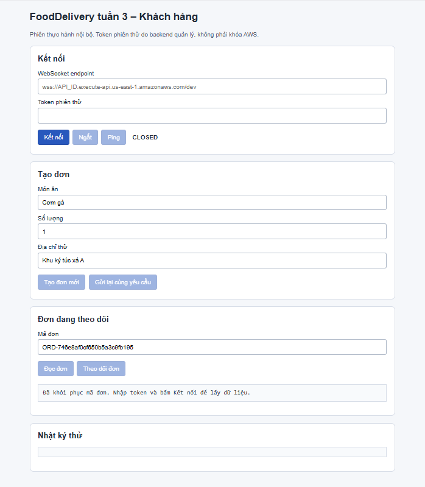
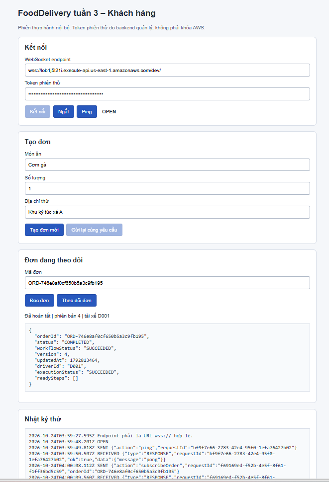

### W3-TV2-03 — Tự kết nối lại sau khi mất mạng
- Ngày thực hiện: 24/10/2026.
- Kiểm thử trên giao diện khách hàng.
- Đơn kiểm thử: `ORD-746e8af0cf650b5a3c9fb195`.
- Khi ngắt mạng, giao diện chuyển sang OFFLINE, giữ mã đơn
  và khóa các nút yêu cầu kết nối.
- Khi bật mạng trở lại, giao diện tự thử kết nối và chuyển sang OPEN.
- Nhật ký ghi nhận ONLINE, RECONNECT_SCHEDULED và OPEN.
- Snapshot được khôi phục: COMPLETED, version 4, driverId D001,
  executionStatus SUCCEEDED.
- Kết quả: Đạt tình huống mất mạng rồi tự kết nối lại.
- Chưa kiểm thử nhận cập nhật mới sau reconnect và ngắt chủ động.
### Minh chứng
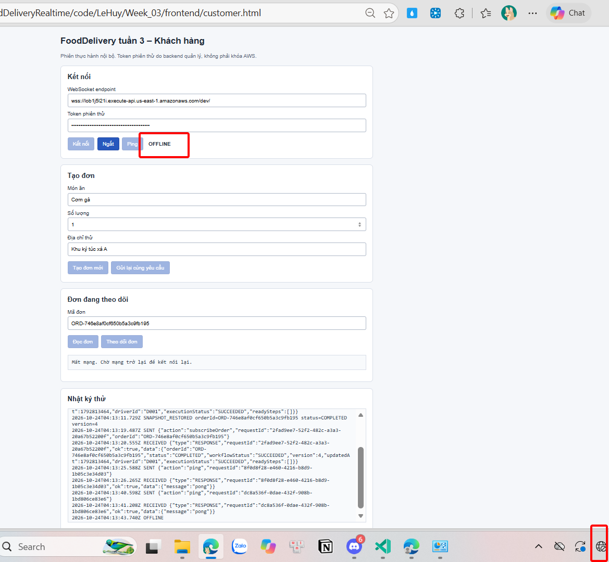
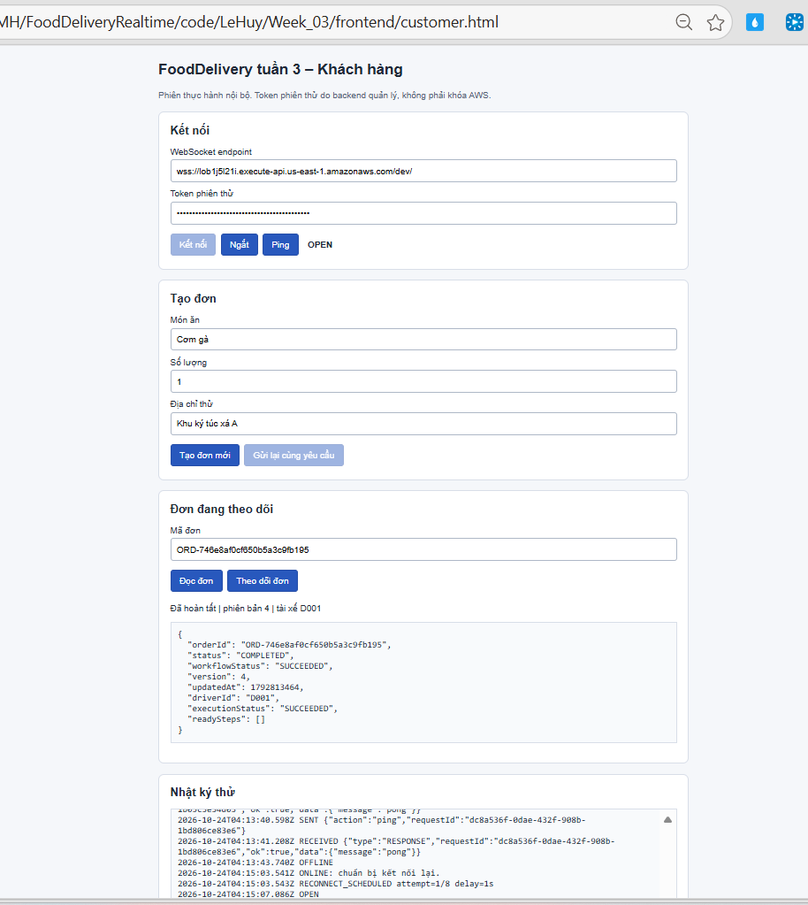

### W3-TV2-03 — Ngắt kết nối chủ động
- Ngày thực hiện: 24/10/2026.
- Bấm Ngắt trên giao diện khách hàng.
- Giao diện chuyển sang CLOSED và khóa các nút cần kết nối.
- Nhật ký ghi DISCONNECTED_BY_USER.
- Không thấy lần thử kết nối lại sau dòng ngắt trong ảnh minh chứng.
- Kết quả: Đạt thao tác ngắt chủ động tại thời điểm chụp.
### Minh chứng
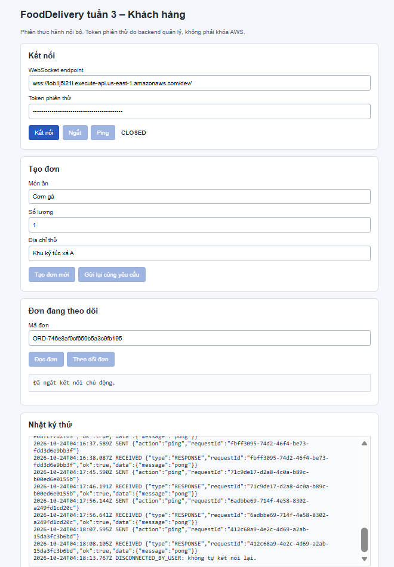

### W3-TV2-03 — Nhận cập nhật mới sau khi kết nối lại
- Ngày thực hiện: 24/10/2026.
- Đơn kiểm thử: `ORD-217c2a03e405d72853e6864b`.
- Sau khi mất mạng rồi có mạng trở lại, giao diện tự kết nối,
  đăng ký theo dõi lại và khôi phục snapshot PLACED, version 1.
- Nhật ký có RESUBSCRIBE và SNAPSHOT_RESTORED.
- Sau khi tài xế D001 nhận đơn, giao diện khách hàng nhận
  ORDER_UPDATED và hiển thị ACCEPTED, version 2.
- Kết quả: Đạt khôi phục theo dõi và nhận cập nhật mới sau reconnect.
### Minh chứng
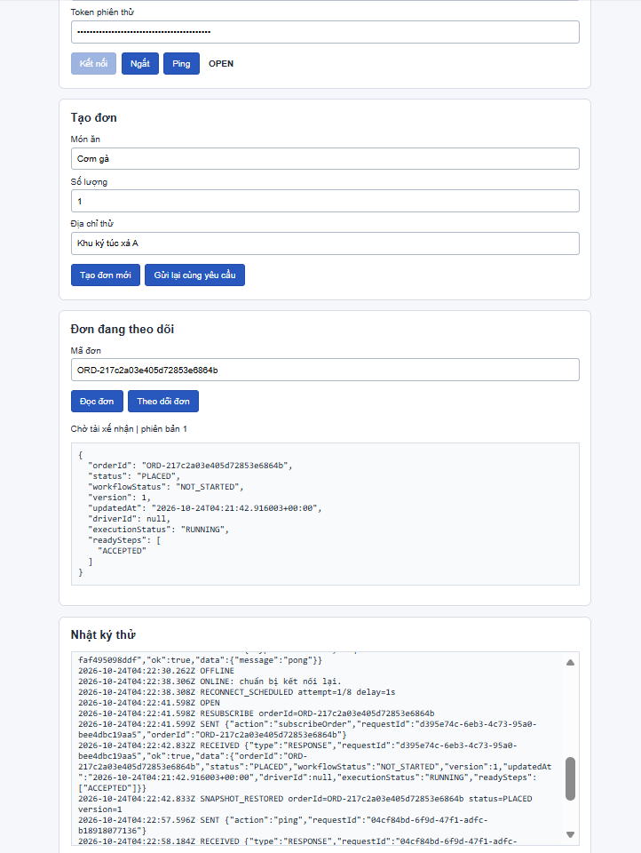
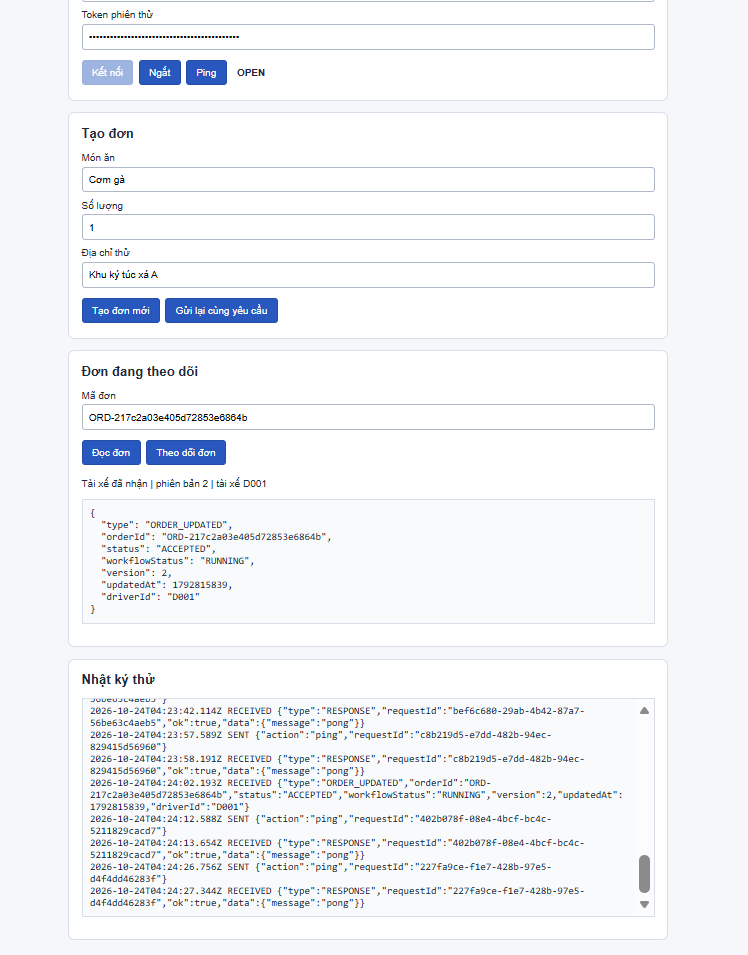

### W3-TV2-04 — Kiểm tra phiên bản cũ và dữ liệu trùng trên giao diện
- Ngày thực hiện: 24/10/2026.
- Đơn kiểm thử: `ORD-746e8af0cf650b5a3c9fb195`.
- Snapshot ban đầu: COMPLETED, version 4, driverId D001.
- Phương pháp: gọi trực tiếp hàm render trong Console trình duyệt.
#### Phiên bản cũ
- Đưa dữ liệu ACCEPTED, version 2 vào hàm render.
- Nhật ký ghi IGNORED_OLD_VERSION, received=2, current=4.
- Giao diện giữ COMPLETED, version 4.
- Kết quả: Đạt.
### Minh chứng
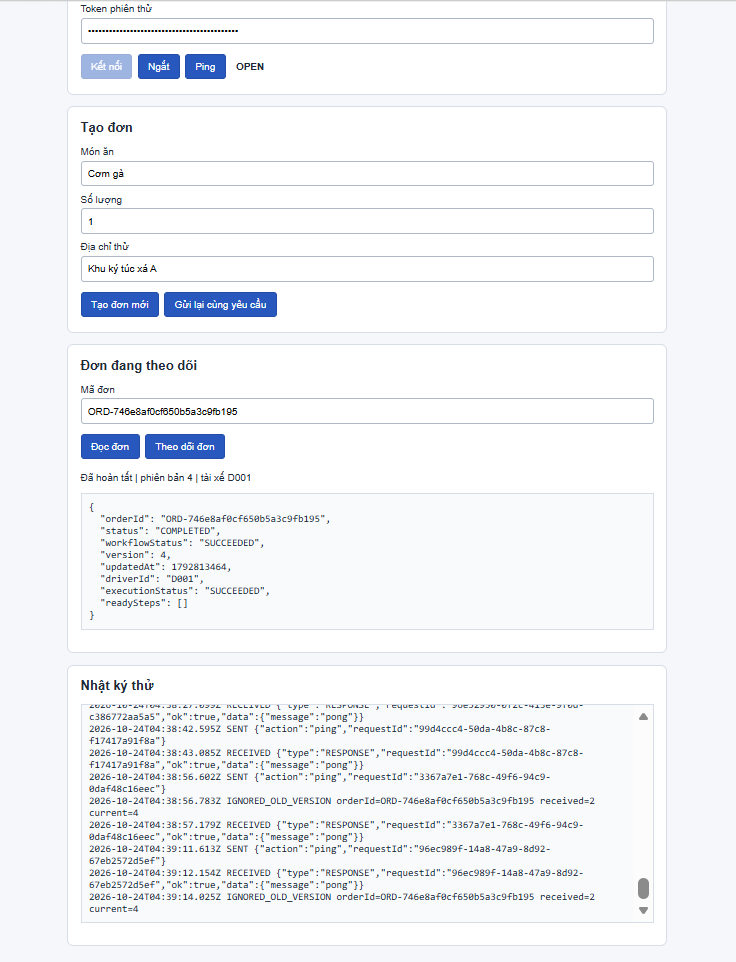
#### Dữ liệu trùng
- Gọi render hai lần với cùng snapshot hiện tại.
- Giao diện giữ COMPLETED, version 4, driverId D001.
- Kết quả: Đạt.
### Minh chứng
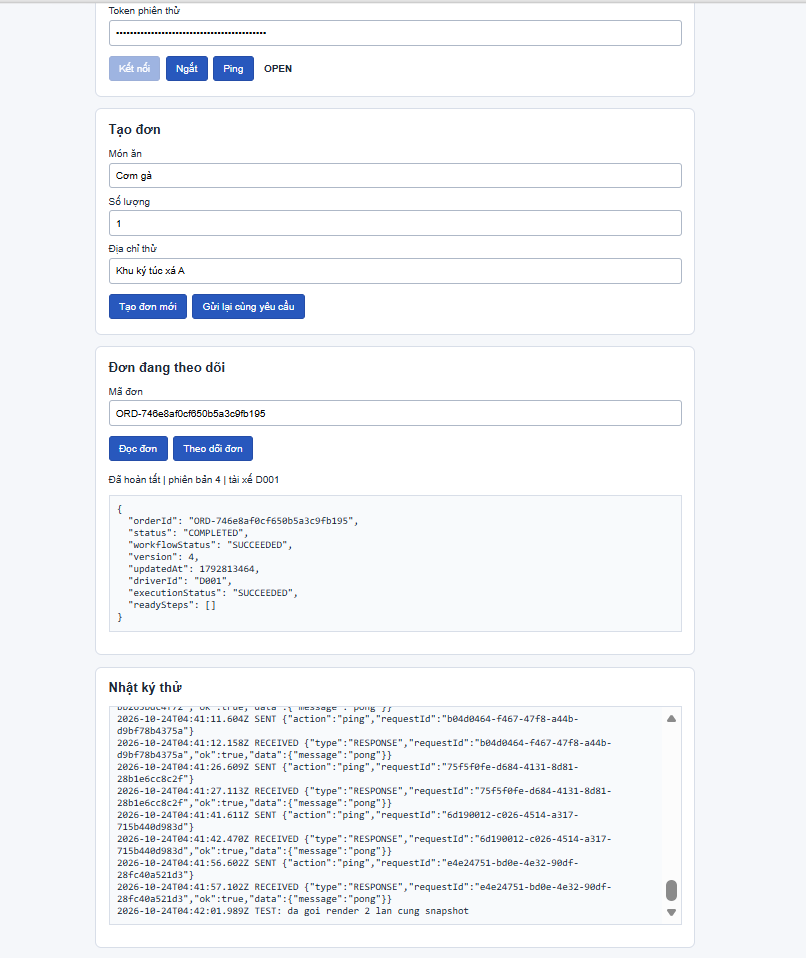
Lưu ý: Đây là kiểm thử mô phỏng xử lý hiển thị trên trình duyệt. Chưa xác nhận khả năng chống gửi lặp yêu cầu tại backend.

### W3-TV2-04 — Kiểm tra phân quyền khách hàng
- Ngày thực hiện: 24/10/2026.
- Phiên kiểm thử: C002, sử dụng token được cấu hình ở backend.
- Đơn của C001: `ORD-746e8af0cf650b5a3c9fb195`.
- Gửi getOrder: backend trả ok=false, mã lỗi FORBIDDEN.
- Gửi subscribeOrder: backend trả ok=false, mã lỗi FORBIDDEN.
- Giao diện xóa snapshot cũ và hiển thị thông báo từ chối truy cập.
- Kết nối vẫn OPEN, ping/pong tiếp tục hoạt động.
- Kết quả: Đạt kiểm thử C002 không được đọc hoặc theo dõi đơn của C001.
### Minh chứng
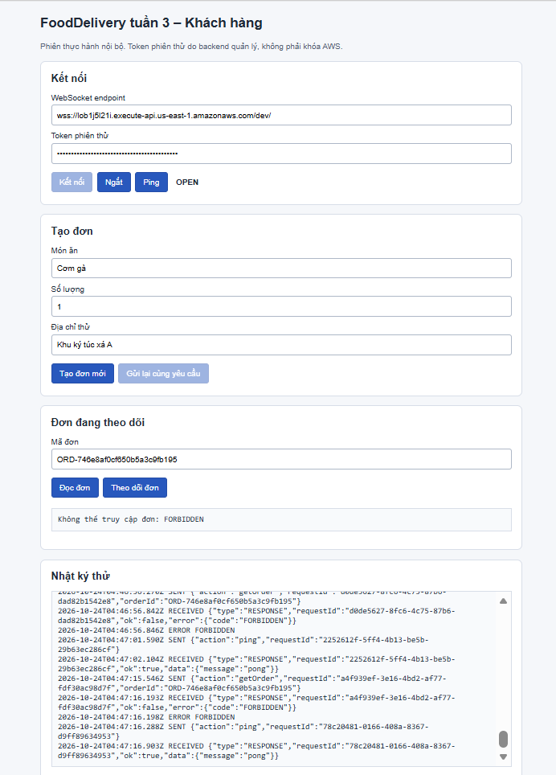
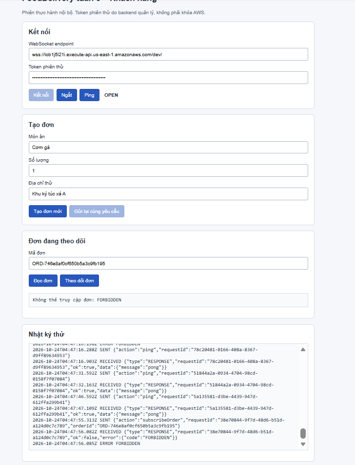

### W3-TV2-04 — Kiểm tra phân quyền tài xế
- Ngày thực hiện: 24/10/2026.
- Phiên kiểm thử: D002.
- Đơn kiểm thử: `ORD-746e8af0cf650b5a3c9fb195`,
  đã hoàn tất và được gán cho D001.
- subscribeOrder trả ok=false, mã lỗi FORBIDDEN.
- getOrder trả ok=false, mã lỗi FORBIDDEN.
- Giao diện không hiển thị snapshot của đơn.
- Các nút Nhận đơn, Bắt đầu giao và Hoàn tất đều bị khóa.
- Kết nối WebSocket vẫn OPEN.
- Kết quả: Đạt kiểm thử D002 không được đọc hoặc theo dõi
  đơn đã gán cho D001.
### Minh chứng
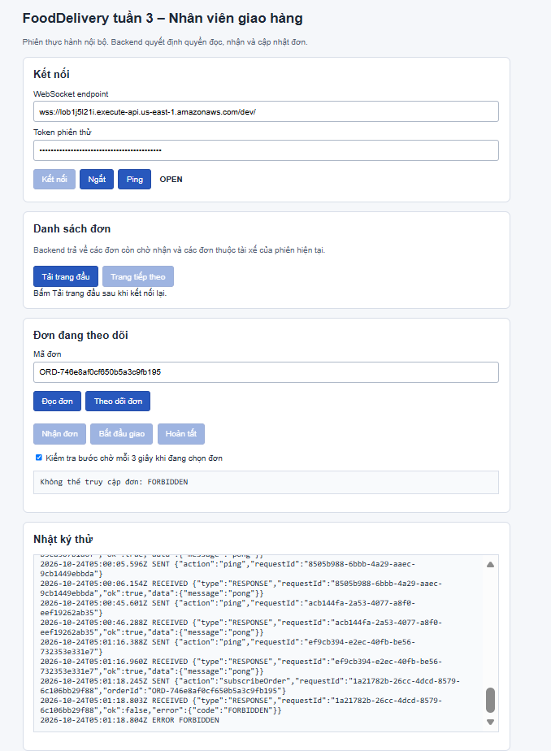
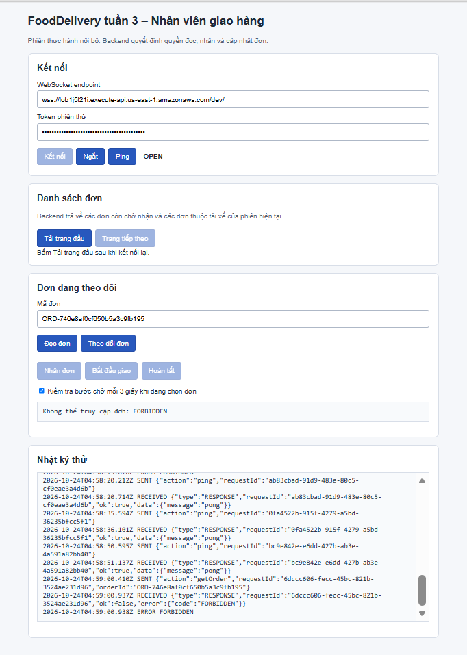

### W3-TV2-05 — Bổ sung log truy vết dispatcher
- Ngày thực hiện: 24/10/2026.
- Bổ sung log JSON cho Lambda fooddelivery-ws-dispatcher.
- Ghi action, requestId, lambdaRequestId, connectionId,
  orderId, actorId, role, outcome, code, delivered và durationMs.
- Điều chỉnh bộ lọc để connectionId được ghi đầy đủ.
- Kiểm thử: D002 gửi getOrder cho đơn
  `ORD-746e8af0cf650b5a3c9fb195` đã gán cho D001.
- CloudWatch ghi nhận code FORBIDDEN và delivered=true.
- Bản ghi kiểm tra không chứa token, địa chỉ hoặc taskToken.
- Kết quả: Đạt ghi log yêu cầu bị từ chối tại dispatcher.
- Log broadcast: Chưa kiểm tra.
### Minh chứng
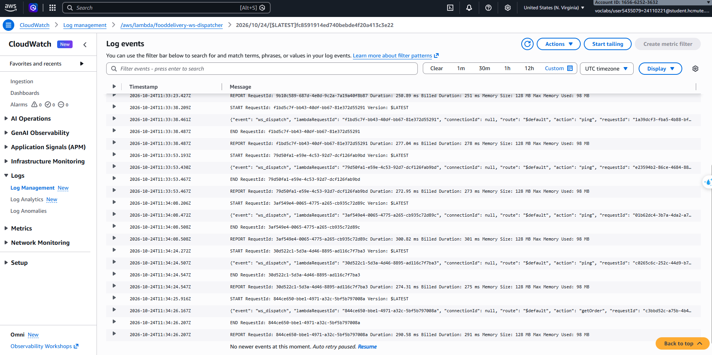
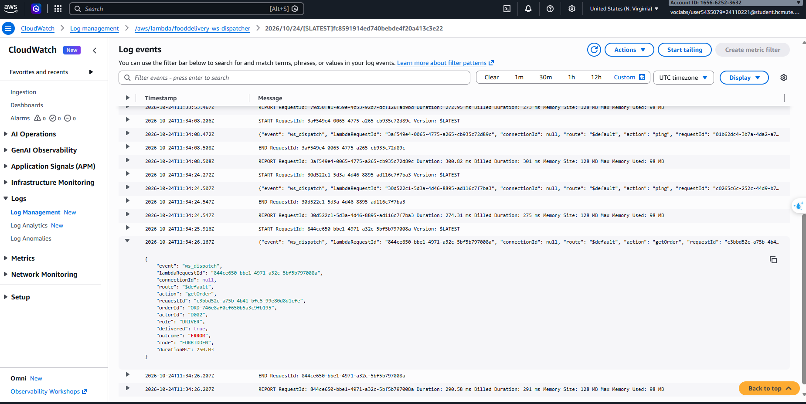
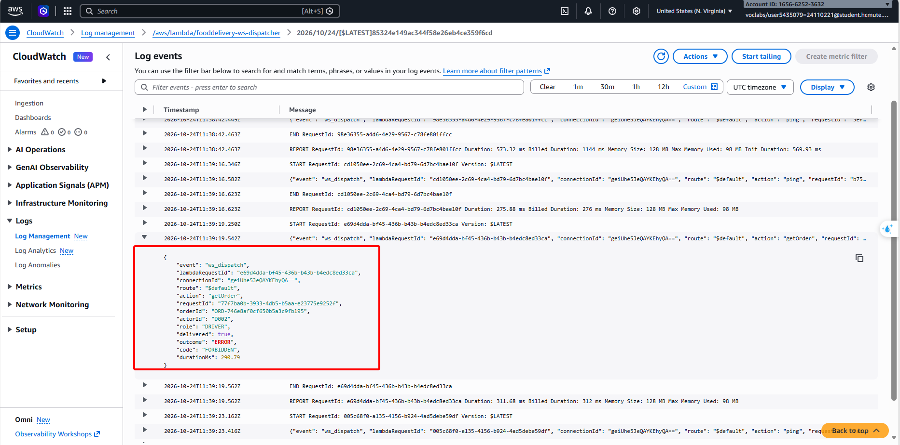

### W3-TV2-05 — Bổ sung và kiểm tra log broadcast
- Ngày thực hiện: 24/10/2026.
- Bổ sung log JSON cho Lambda fooddelivery-broadcast.
- Ghi lambdaRequestId, orderId, status, version, outcome, code,
  sent, skipped, gone và durationMs.
- Chạy Lambda Test để phát lại snapshot của đơn
  `ORD-746e8af0cf650b5a3c9fb195`.
- CloudWatch ghi COMPLETED, version 4, BROADCAST_FINISHED.
- Kết quả gửi: sent=1, skipped=0, gone=0.
- Bản ghi kiểm tra không chứa token, địa chỉ hoặc taskToken.
- Kết quả: Đạt kiểm thử log broadcast thành công.
- Các nhánh skipped, gone và lỗi gửi chưa được kiểm thử trong lần này.
### Minh chứng
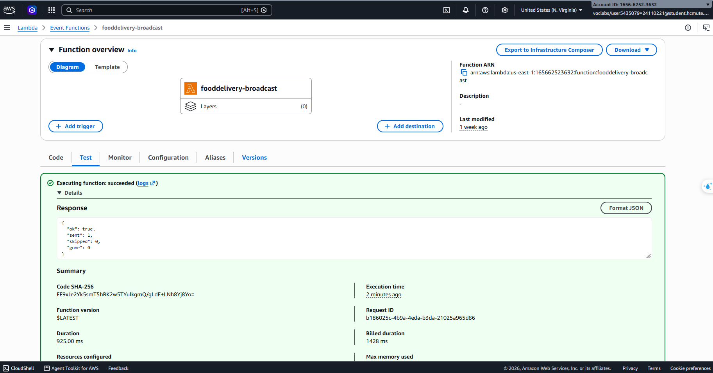
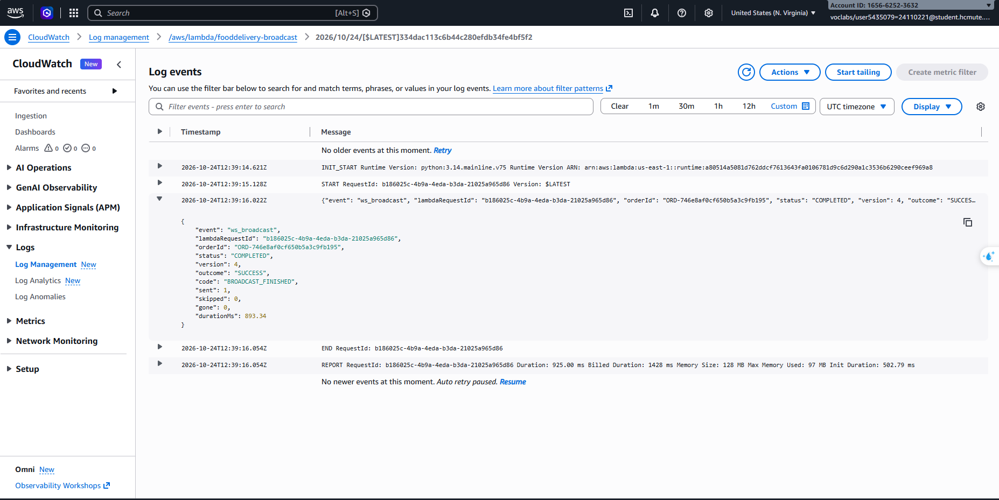

### W3-TV2-06 — Kiểm tra bấm Nhận đơn liên tục
- Ngày thực hiện: 24/10/2026.
- Đơn kiểm thử: `ORD-d709117de766c314d9e6e0ce`.
- Thực hiện bấm nhanh nút Nhận đơn nhiều lần trên giao diện D001.
- Giao diện nhận phản hồi QUEUED, sau đó nhận ORDER_UPDATED.
- Snapshot sau nhận đơn: ACCEPTED, version 2, driverId D001.
- Tìm trên toàn bộ log streams theo action updateOrderStatus
  và mã đơn trong khoảng thời gian kiểm thử: một bản ghi.
- Bản ghi có actorId D001, code OK và delivered=true.
- requestId khớp phản hồi trên giao diện.
- Kết quả: Đạt chặn thao tác bấm lặp tại frontend trong lần thử này.
- Chưa dùng kết quả này để kết luận backend chống yêu cầu trùng.
### Minh chứng
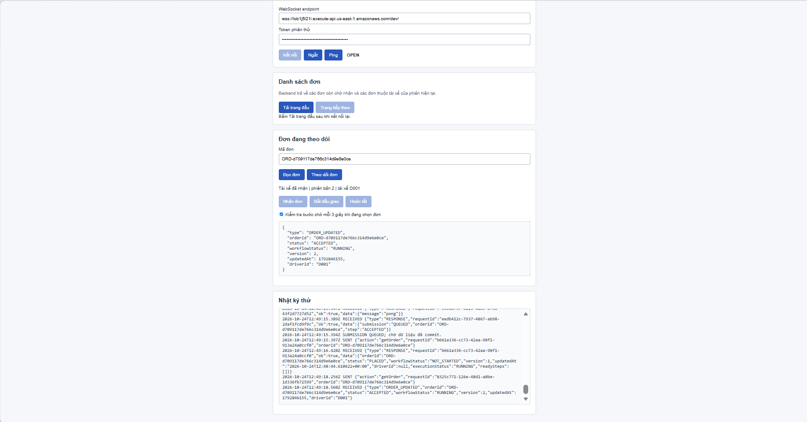
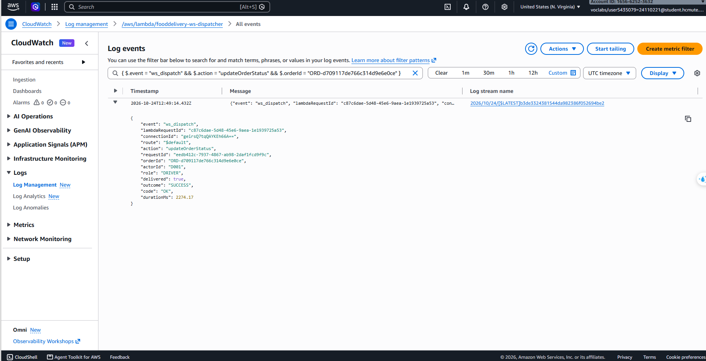